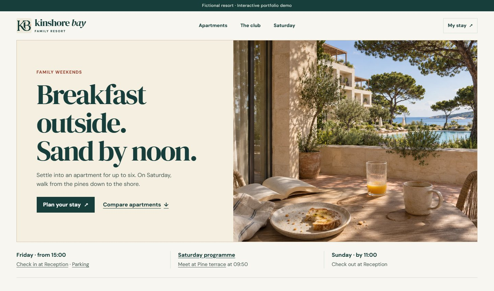

# Kinshore Bay

[PostgreSQL concurrency test · SELECT FOR UPDATE](https://github.com/yourkeey/kinshore-bay/blob/654edf10c7adc81c3e8c01b87304359588b10f87/crm/reception/test_desk.py#L80-L121) · [Passing GitHub Actions run](https://github.com/yourkeey/kinshore-bay/actions/runs/45025269566)

A booking and reception demo for a fictional Mediterranean family resort. The same stay request connects the guest’s apartment search, the receptionist’s assignment, and the family’s plans in **My stay**.

[Live demo](https://kinshore-bay.scalo.biz/) · [Telegram Mini App](https://t.me/KinshoreBay_app) · [22-second walkthrough](docs/media/kinshore-bay-demo.webm) · [Case study](docs/PORTFOLIO-CASE.md)



## Try a family weekend

1. Open **Poolside One Bedroom**, check the floor plan, and choose a Friday-to-Sunday stay for four guests. The seeded rate is €135 per night.
2. Send a demo request and copy its reference from **My stay**.
3. Select **Open demo reception** in the planner. Find the reference, assign a free apartment, and confirm the stay.
4. Return to **My stay**, refresh the request, and book two places on **Pine & Shore Walk**. Reception shows both places under the same reference.

The public website and Mini App each use a browser session to remember the demo workspace. Telegram chat submissions go to a separate preview CRM. All inventory, stays, prices, and images represent a fictional resort.

## Run locally

Start with Python 3.12. The guest site and Reception run together with Django and SQLite. Telegram credentials are only needed to run your own bot.

**Windows PowerShell**

```powershell
python -m venv crm/.venv
& crm/.venv/Scripts/python.exe -m pip install -r crm/requirements.txt
& crm/.venv/Scripts/python.exe site/preview.py
```

**macOS or Linux**

```sh
python3 -m venv crm/.venv
. crm/.venv/bin/activate
python -m pip install -r crm/requirements.txt
python site/preview.py
```

The preview migrates and seeds the database. Open the [guest site](http://127.0.0.1:8765/) and use the same port for [Reception](http://127.0.0.1:8765/reception/). For the local staff login, run `python crm/manage.py create_reception_user receptionist` in a second terminal using the virtual environment’s Python. The command prompts for a password. Optionally run `python crm/manage.py seed_demo --shift` to add a sample shift.

## How it works

| Component | What it does |
| --- | --- |
| Guest site and Mini App | Vanilla JavaScript, shared apartment catalogue, availability, stay requests, and activities |
| Django CRM | Reception workflow, room assignment, status history, walks, and grill reservations |
| Data | SQLite for the local preview, PostgreSQL for public demo workspaces and concurrency tests |
| Telegram | Python Bot API client, in-chat planner, Mini App launch, and retryable CRM submissions |
| Deployment | Docker Compose, Gunicorn, and Caddy or an existing HTTPS proxy |

See the [architecture](docs/ARCHITECTURE.md), [CRM guide](crm/README.md), [bot setup](bot/README.md), and [public deployment guide](deploy/PUBLIC-DEMO.md).

## Run the tests

Install the [Node.js runtime](https://nodejs.org/) for the JavaScript checks. Run Python with the virtual environment active or substitute its executable path on Windows.

```sh
python -m pip install -r requirements-dev.txt
python crm/manage.py test reception
python -m unittest discover -s bot
node site/test_miniapp.js
python -m playwright install chromium
python site/check_guest_route.py
```

The browser suite uses a temporary database and runs the guest-to-reception route at three viewport widths. GitHub Actions also runs PostgreSQL concurrency checks, builds the deployment ZIP, and starts the packaged public demo with Docker Compose to check that Reception loads. See [local PostgreSQL instructions](crm/README.md#проверка).

## Credits

The resort, its inventory, and guest records are fictional. See [visual asset provenance](docs/ASSETS.md) for the illustrations and brand assets.
