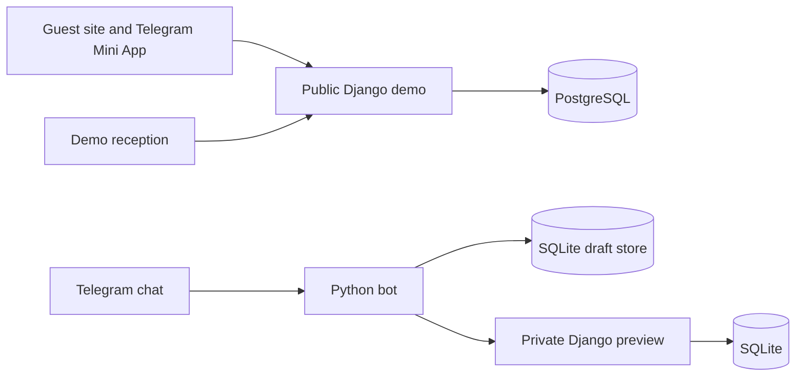

# Architecture

Kinshore Bay is a portfolio demo for a fictional resort. Django owns the inventory, pricing, and state changes for stays and activities. The browser and Telegram bot provide separate entry points.

## Guest and reception flow

1. The planner requests quotes using dates and party size. Django checks demo availability and returns categories with the total in cents. The shared [catalogue](../content/en.json) supplies room descriptions and the initial seed data.
2. A guest submits a request. Django records the quoted nightly rate, applies its validation rules, and returns a reference. Retrying the same request in the same session returns the existing reference.
3. Reception selects an available unit. PostgreSQL locks that unit during confirmation, and the service rechecks overlapping confirmed stays before writing the status and history.
4. **My stay** shows the current status and activities for confirmed stays. Walk booking and cancellation update capacity in the same transaction. Reception manages grill slots and sees walk attendance by date.

## Deployment modes

- **Local preview.** Django uses SQLite. Staff sign in with a locally created account. Start with [Run locally](../README.md#run-locally).
- **Public demo.** PostgreSQL stores fictional records. The browser session scopes requests, reception activity, and capacity for 24 hours. Visitors can try Reception in the same workspace. See [public deployment](../deploy/PUBLIC-DEMO.md).
- **Private Telegram preview.** The bot uses a service credential to create CRM requests. Its SQLite draft store preserves the retry key across restarts. The Mini App opens the public planner, where **My stay** belongs to the WebView’s browser session. See [bot setup](../bot/README.md) and [draft recovery](OUTBOX-PLAN.md).

The demo uses simulated inventory and collects no guest contact details. Cross-device history and real reservations are outside its scope.
